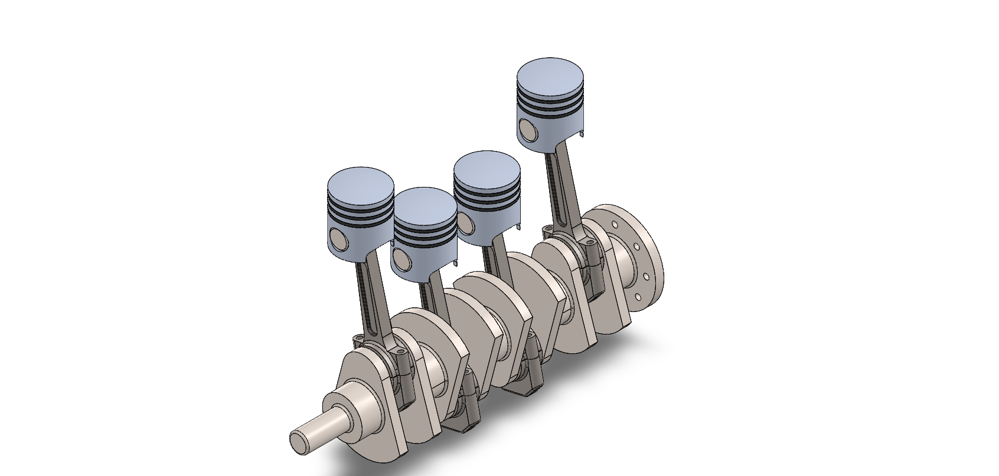
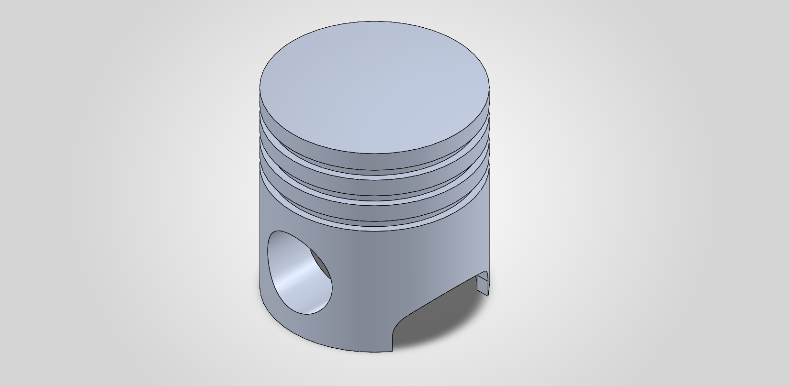
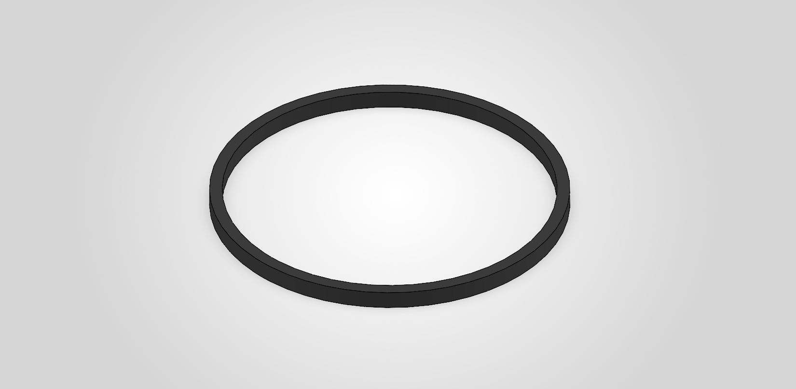
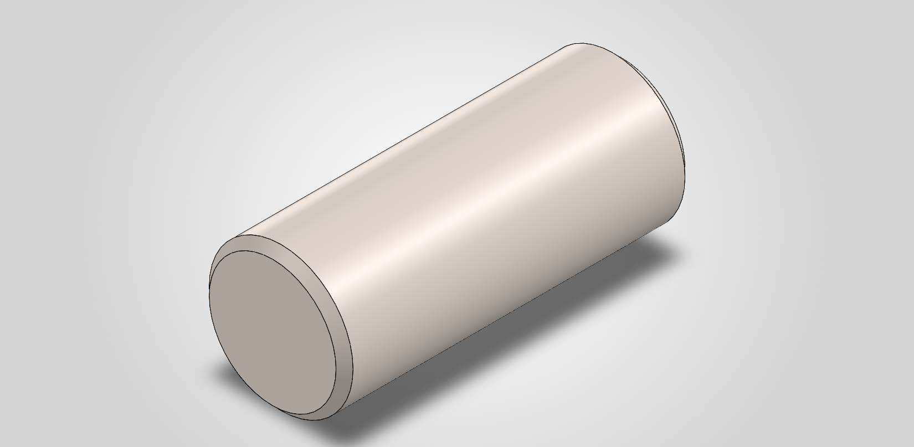
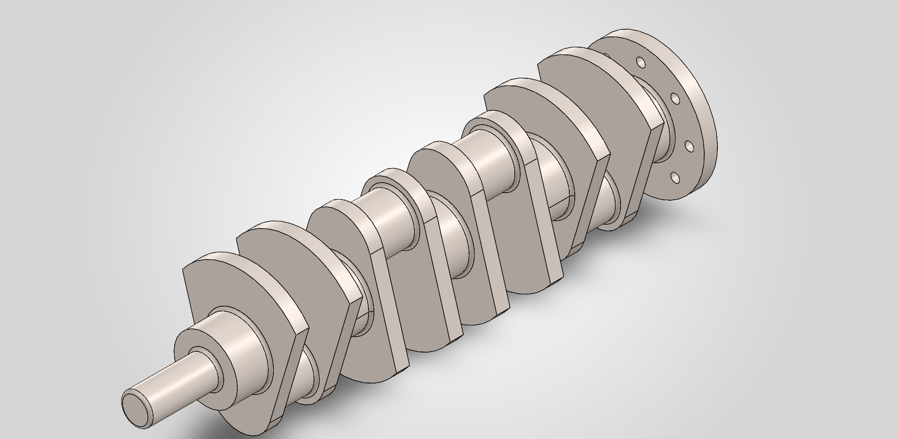
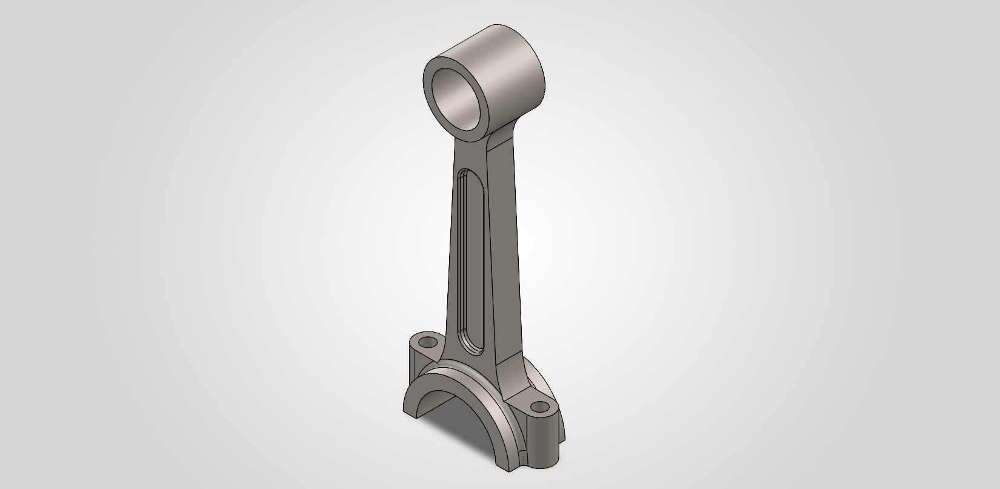
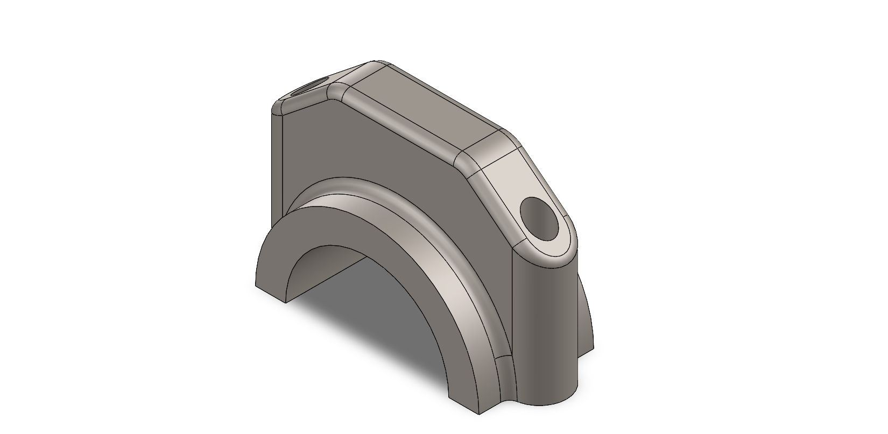

# Four-Cylinder Engine Design
### 3D CAD Modelling and Assembly Using SolidWorks



## 1. Project Overview

This project focuses on the 3D CAD modelling and assembly of a four-cylinder engine mechanism using SolidWorks.

The project involves designing individual mechanical components and integrating them into an assembly to understand the relationship between reciprocating and rotary motion in an internal combustion engine.

The individual components were modelled separately and subsequently assembled to create a four-cylinder piston and crankshaft mechanism.

## 2. Software Used

- **SolidWorks** – 3D CAD Modelling and Assembly Design
- **GitHub** – Project Documentation and Version Control

## 3. Individual Components Designed

The following six mechanical components were individually modelled using SolidWorks.

| S.No. | Component | File Format | Status |
|---|---|---|---|
| 1 | Piston | SLDPRT | Completed |
| 2 | Piston Rings | SLDPRT | Completed |
| 3 | Piston Pin | SLDPRT | Completed |
| 4 | Crankshaft | SLDPRT | Completed |
| 5 | Connecting Rod | SLDPRT | Completed |
| 6 | Connecting Rod Cap | SLDPRT | Completed |

## 4. Individual Component Gallery

### 4.1 Piston

The piston is a reciprocating component that moves inside the cylinder and transfers combustion force to the connecting rod.



**CAD File:** `parts/Piston.SLDPRT`

### 4.2 Piston Rings

Piston rings provide sealing between the piston and cylinder wall, help control lubricating oil and maintain compression.



**CAD File:** `parts/Piston_ring.SLDPRT`

### 4.3 Piston Pin

The piston pin connects the piston to the connecting rod and allows relative movement between them.



**CAD File:** `parts/Piston_pin.SLDPRT`

### 4.4 Crankshaft

The crankshaft converts the reciprocating motion of the pistons into rotary motion through the connecting rods.



**CAD File:** `parts/Crankshaft.SLDPRT`

### 4.5 Connecting Rod

The connecting rod connects the piston to the crankshaft and transmits forces between them.



**CAD File:** `parts/Connecting_Rod.SLDPRT`

### 4.6 Connecting Rod Cap

The connecting rod cap forms the detachable lower portion of the connecting rod's big end and secures it around the crankshaft journal.



**CAD File:** `parts/Connecting_rod_Cap.SLDPRT`

## 5. Four-Cylinder Engine Assembly

After completing the individual component models, the components were integrated using SolidWorks Assembly.

The assembly demonstrates the arrangement of four pistons, connecting rods and the crankshaft mechanism.

### Final Assembly Model


**Assembly File:** `Assembly/Four-Cylinder-Engine-Assembly.SLDASM`

### Assembly Highlights

- Integration of four piston mechanisms.
- Connecting rod and piston pin arrangement.
- Crankshaft integration.
- Assembly of connecting rod caps.
- Understanding the relationship between reciprocating and rotary motion.

## 6. Repository Structure

```text
Four-Cylinder-Engine-Design/
│
├── parts/
│   ├── Connecting_rod_Cap.SLDPRT
│   ├── Connecting_Rod.SLDPRT
│   ├── Crankshaft.SLDPRT
│   ├── Piston_pin.SLDPRT
│   ├── Piston_ring.SLDPRT
│   └── Piston.SLDPRT
│
├── parts_Images/
│   ├── Connecting_rod_Cap.PNG
│   ├── Connecting_Rod.PNG
│   ├── Crankshaft.PNG
│   ├── Piston_pin.PNG
│   ├── Piston_ring.PNG
│   └── Piston.PNG
│
├── Assembly/
│   └── Four-Cylinder-Engine-Assembly.SLDASM
│
├── Assembly_Images/
│   └── Four-Cylinder-Engine-Assembly.PNG
│
├── .gitattributes
└── README.md
```

## 7. Future Improvements

- Develop the complete engine block and cylinder arrangement.
- Add additional engine components.
- Perform motion studies to demonstrate crankshaft rotation and piston movement.
- Improve the assembly with additional mechanical details.
- Generate realistic renders and animations.
- Explore engineering analysis and simulation.

## 8. Project Status

| Development Stage | Status |
|---|---|
| Individual Part Modelling | Completed |
| Component Assembly | Completed |
| Assembly Documentation | Completed |
| Motion Study | Planned |
| Complete Engine Development | Future Work |

## 9. Author

**Rajasri S**

B.E. Mechatronics Engineering

*This project represents my learning journey in mechanical design, CAD modelling and mechanical assembly using SolidWorks.*